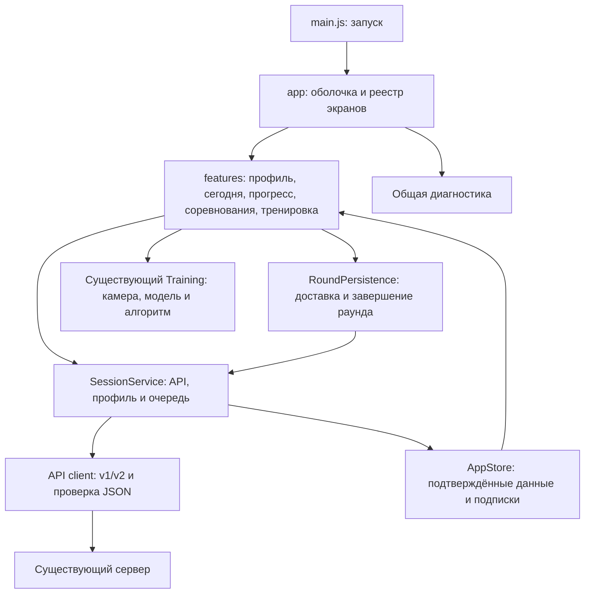

# Клиент приложения — 2.5.4

Основной репозиторий — `APP-updated-version-`, ветка `main`, проверенный выпуск на момент этого описания — 2.5.4. Перед новой задачей сверяйте актуальные `package.json`, `src/config.js`, ветку и SHA. Модульный клиент реализован на базе 93721f8 и перенесён в основной проект в составе d0c2f384. Общая инструкция команды: [TEAM_CONTEXT.md](TEAM_CONTEXT.md); роль frontend: [team/FRONTEND.md](team/FRONTEND.md). Актуальный процесс разработки и CI: [DEVELOPMENT.md](DEVELOPMENT.md).

## Устройство приложения

Клиент остаётся приложением на ES modules, Vite и Capacitor. React и библиотека глобального состояния не добавлены. Новые модули написаны на TypeScript; движок распознавания и существующие адаптеры постепенно подключаются через описанные интерфейсы.

- src/app/bootstrap.ts создаёт сервисы, профиль, диагностику и экраны; подключает события платформы. Здесь нет шаблонов отдельных экранов и правил тренировки.
- src/app/registry.ts содержит шаблон, название, значок и фабрику каждого экрана. Навигация и создание корней DOM используют этот реестр.
- src/app/navigation.ts открывает зарегистрированный экран, закрывает предыдущий и вызывает его жизненный цикл. Фоновое обновление данных отделено от открытия экрана.
- src/app/store.ts применяет снимки и страницы истории. Изменение состояния выполняется через apply/page/reset; экраны читают данные и не присваивают поля общего состояния.
- src/services/session.ts согласует версию API, управляет загрузкой, профилем и единственной очередью Outbox. История продолжает загружаться через существующий HistoryLoader.
- src/services/round-persistence.ts сохраняет события до отправки, ждёт локальных записей, опустошает очередь перед завершением раунда и восстанавливает неподтверждённое завершение.

## Владельцы интерфейса

| Модуль | Содержимое |
| --- | --- |
| features/profile | Гостевой вход, существующая панель профиля, имя, согласие на рейтинги, выход и ссылка APK |
| features/today | Дневное задание, календарь, текущая неделя, места пользователя и карточка непросмотренного итога |
| features/progress | Рекорд, сравнение, график, страницы раундов и недельных итогов |
| features/competitions | Приглашения и дуэли, отдельный контроллер рейтингов League, чистые функции разметки карточек и таблицы |
| features/training | Контроллер подготовки/запуска/остановки и отдельное представление тренировки |
| diagnostics/coordinator | Подключение общей панели, состояния соединения и действий проверки/повторной отправки |

Прежний WeeklyUI разделён. Текущая неделя принадлежит «Сегодня», история итогов — «Прогресс», рейтинги — «Соревнования». Общее форматирование недель и сравнение результатов находятся в shared и не обращаются к чужому DOM.

Каждый экран получает свой root и FeatureContext с сервисами и командами навигации. Корни монтируются один раз: фоновая синхронизация не пересоздаёт видеоэлемент и формы. Переход на другой экран останавливает камеру в прежнем порядке; очередь от навигации не зависит. Lifecycle удаляет общие слушатели и интервалы при завершении приложения; контроллеры освобождают свои ресурсы.

Диагностика подключена один раз вне экранов и остаётся закреплённой внизу. Управление сервером находится в ней. Существующие ActivityLog, Diagnostics и DiagnosticsPanel сохраняются; журнал продолжает ограничиваться 300 событиями и исключать кадры, координаты, имена, токены и приглашения.

## Данные и TypeScript

Общие контракты находятся в src/shared/contracts/api.ts: профиль, дни, раунды, соревнования, недели, рейтинги, запросы, ответы, пагинация и ошибки. Полный снимок v1, dashboard v2 и частичное подтверждение записи v2 представлены разными типами. Календарные даты имеют формат YYYY-MM-DD, серверные временные метки — миллисекунды Unix, локальная очередь отправляет время события в ISO-формате.

src/shared/contracts/validate.ts проверяет реальные ответы до изменения состояния. Дополнительные совместимые поля разрешены. Некорректный ответ даёт API_RESPONSE_INVALID и сохраняет ранее подтверждённые данные. Описания не импортируют Node.js, D1, секреты или серверную реализацию. Соответствие существующего сервера проверяется контрактными тестами на реальных ответах обработчиков v1/v2.

Существующий createDataClient сохраняет переключение на старый API только при ожидаемом 404; сетевые ошибки не маскируются. mergeState сохраняет страницы истории при коротком ответе и не применяет старую ревизию. AppStore и SessionService дополнительно отклоняют ответы предыдущего сеанса. При замене профиля прежняя очередь закрывается до смены учётных данных; её неподтверждённые записи не удаляются и не отправляются от нового владельца.

В tsconfig.json включены strict, проверка неиспользуемых объявлений и erasableSyntaxOnly. Последнее позволяет выполнять общие TS-модули в тестах на Node.js 24 без дополнительного преобразователя. Старый JS не переводится массово; границы Training, Outbox, подготовки, звука и функций прогресса описаны в соседних .d.ts. Проверка типов отделена от сборки Vite.

## Стили и добавление экрана

Статические HTML-фрагменты находятся рядом с модулями. Динамическая разметка форматируется как HTML внутри шаблонов; пользовательский текст экранируется, включая имя победителя в итогах дуэли.

src/style.css подключает общие базовые стили, стили функций и общую мобильную типографику. Стили функций ограничены :where([data-feature='имя']). Такой префикс не увеличивает специфичность селектора. Оболочка сохраняет место под диагностику и безопасные отступы устройства. При переносе проверялось соответствие вычисленных стилей исходному CSS на мобильной и настольной ширине.

Чтобы добавить экран:

1. Создать модуль в src/features/имя с template.html, контроллером и собственными стилями. Корневой раздел имеет id="tab-имя" и class="tab-content"; для новых стилей можно импортировать ./style.css из контроллера.
2. Фабрика получает root, FeatureContext и при необходимости общие сервисы. Возвращает root, render и нужные операции activate, refresh, deactivate, destroy. Запросы запускаются действиями или жизненным циклом; render отображает данные.
3. Добавить запись в screens в app/registry.ts: label, icon, html, create. Оболочка сама создаст пункт навигации и подключит экран к обновлениям. Другие экраны и bootstrap менять не нужно.
4. Описать новые данные/запросы в shared/contracts, если изменяется API. Схему базы и серверные правила согласовывать отдельно.
5. Проверить типы, сборку и затронутые пользовательские сценарии. Для переходов к другим функциям использовать команды контекста; не искать их элементы через document.

## Проверки и тестовый выпуск

Команды:

- npm run typecheck — строгая проверка новых TS-модулей и границ старого JS.
- npm run format:check — форматирование перенесённого клиента, новых тестов и инструментов.
- npm run lint — проверка синтаксиса каждого JS/MJS-файла в src/server/scripts/tests.
- npm test — unit/integration, включая контракт сервера, устаревший ответ сеанса, сохранение страниц, освобождение ресурсов и порядок завершения раунда.
- npm run build и npm run backend:validate — сборка и упаковка существующего Worker без публикации.
- npm run test:browser:all — последовательные браузерные проверки на отдельных временных SQLite в режимах cookie и device. Требуются Chromium/Chrome и playwright-core, задаваемые CHROMIUM_PATH и NODE_PATH. Тестовые позиции тела относятся только к стенду.

CI запускает весь браузерный набор до сборки APK. APK собирается после push в main или явного ручного запуска; деплой — отдельный ручной workflow единственного основного сервера. Совместимый Android-пакет остаётся «Движение Тест UI», com.movement.squat.staging.ui; проверенный выпуск — 2.5.4 / 20504. Для следующей задачи версия берётся из текущих исходников и метаданных APK. Сборка проверяет закреплённый сертификат; при отсутствии постоянного ключа она останавливается. Подпись и Actions secret описаны в [ANDROID_SIGNING.md](ANDROID_SIGNING.md).

Физический Galaxy S23 в среде не подключён. При архитектурном переносе отдельно проверялись загрузка/инференция настоящей модели и восстановление после ошибок; результаты того этапа, включая ограничения headless, сохранены в [архивном отчёте](CLIENT_ARCHITECTURE_REPORT.md). Они не являются новым запуском проверок для каждой следующей версии. Проверки на искусственной камере не заменяют проверку реальной камеры, точности подсчёта и производительности на телефоне. Модель, WASM и параметры распознавания меняются только в задаче, прямо затрагивающей их.

Текущее основное приложение обновляется поверх установленного «Движение Тест UI» без удаления данных. Пакет, закреплённый ключ и адрес API сохранены; схема установки отдельных тестовых пакетов относится к архивному этапу. После объединения используется один основной Worker; прежний Worker удалён, его D1 сохранена архивом. Текущая инфраструктура описана в [SINGLE_SERVER.md](SINGLE_SERVER.md), факты последнего объединения — в [отчёте выпуска 2.5.4](releases/2.5.4-2026-10-23.md).

Для ручной проверки используются отдельный проверочный профиль и сценарий обновления уже установленного приложения: сохранение профиля, камера и разрешение, обычная тренировка, минутный раунд, прерывание и возврат сети. Не удаляйте основной профиль ради проверки. Результаты новых проверок фиксируются в соответствующем PR или отчёте нового выпуска; [CLIENT_ARCHITECTURE_REPORT.md](CLIENT_ARCHITECTURE_REPORT.md) остаётся историческим отчётом архитектурного переноса.

## Программы тренировок · MOV-MVP-01

Расширение сохраняет четыре раздела и текущий светлый дизайн.
На «Сегодня» добавлены четыре программы разработчика и подтверждённые XP/серия,
в «Мой прогресс» — история программ. Камера программы находится внутри
существующего раздела «Тренировка», рядом с прежними режимами.

- [WorkoutsService](../src/services/workouts.ts) координирует отдельный журнал,
  sync, подтверждение закрытия, ActivityProgress и страницы истории.
- [WorkoutStorage](../src/services/workout-storage.ts) сохраняет событие с UUID
  и прогресс одной IndexedDB-транзакцией. Журнал изолирован по API/профилю.
  Версия записи защищает от перезаписи более свежей очереди другой вкладкой.
- [integration.ts](../src/features/workouts/integration.ts) согласует lifecycle
  прежней тренировки и нового runner: одновременно камерой владеет один режим.
- [runner.ts](../src/features/workouts/runner.ts) управляет явным стартом,
  подготовкой/отсчётом, упражнениями, отдыхом, паузой и итогом. При уходе в фон
  и навигации камера освобождается. Продолжение после reload только явное,
  не позже 24 часов; скрытое время не создаёт plank-интервалов.
- Новый клиент использует прежний web/native transport с явным v2-prefixed
  маршрутом. Program API не переключается на v1 и не создаёт гостевой вход
  фоновым запросом. Runtime JSON проверяется до изменения очереди или UI.
- [workouts.ts](../src/shared/contracts/workouts.ts) и
  [validate-workouts.ts](../src/shared/contracts/validate-workouts.ts) описывают
  новые wire-данные. Общие api.ts/validate.ts интегрированы одним владельцем.
- [catalog.ts](../src/shared/workouts/catalog.ts) задаёт версионированные
  программы разработчика. Сервер фиксирует их состав в выполнении.
  Пользовательского конструктора и ручной коррекции в этой итерации нет.
- Новый [PushupCounter](../src/algorithms/pushup.ts) и
  [PlankCounter](../src/algorithms/plank.ts) используют локальные landmarks
  той же модели Full. Планка возвращает только валидный elapsedMs между
  кадрами; внешний журнал накапливает время после пауз.
  Старый SquatCounter, модель, WASM и пороги squat-v1 сохраняются.

Перед finish/abort сохраняются все локальные записи и подтверждается очередь.
Потерянный ответ повторяется с прежними UUID. Устойчивое намерение закрытия
сохраняется до запроса и восстанавливается после reload. Данные прежней
сессии не применяются к новому владельцу; старый ActivityProgress не откатывает
новую ревизию или serverNow при равной ревизии.

Для offline-reload допускается снимок ранее подтверждённого профиля, связанный
с origin/API и текущим device-secret без сохранения секрета в снимке.
Он используется только при отсутствии сети и ограничен по времени.
Выход/отозванная сессия отменяют доступ к снимку. Такая загрузка не подтверждает
новую серверную авторизацию и не возобновляет старый минутный таймер.

Проверки нового пути: tests/bodyweight.test.js, tests/workout-storage.test.js,
tests/workout-client.test.js, tests/workout-contracts.test.js и
tests/browser-workouts.mjs. Реальная точность отжиманий/планки на телефоне,
нагрев и производительность требуют отдельной физической проверки.
