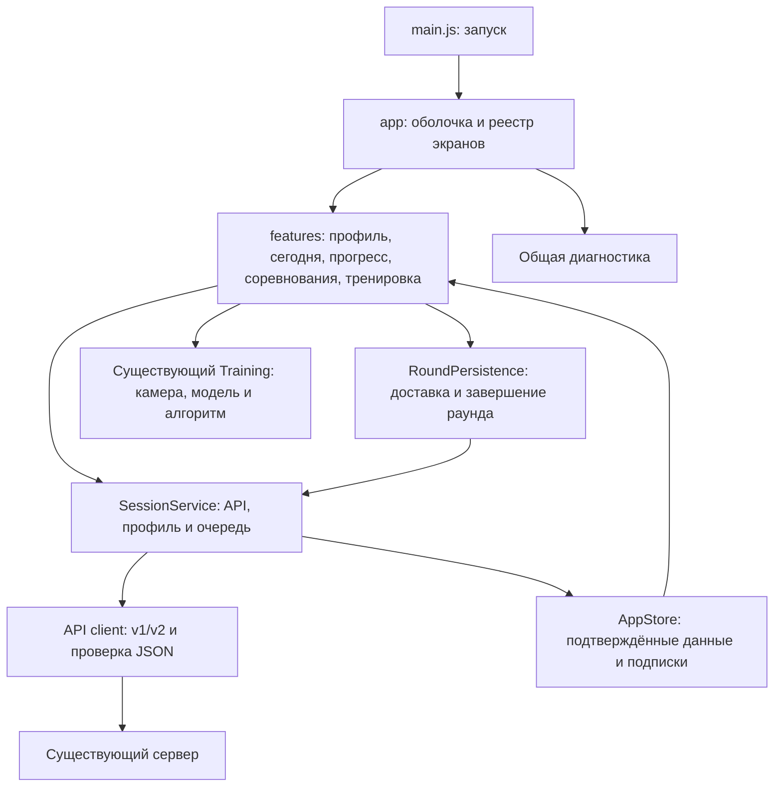

# Клиент приложения — тестовая 2.5.3

Основа изменения: 93721f8, ветка codex/server-optimization. Реализация согласована пользователем 22.10.2026. main и рабочий сервер в это изменение не входят.

## Устройство приложения

Клиент остаётся приложением на ES modules, Vite и Capacitor. React и библиотека глобального состояния не добавлены. Новые модули написаны на TypeScript; движок распознавания и существующие адаптеры постепенно подключаются через описанные интерфейсы.

- src/app/bootstrap.ts создаёт сервисы, профиль, диагностику и экраны; подключает события платформы. Здесь нет шаблонов отдельных экранов и правил тренировки.
- src/app/registry.ts содержит шаблон, название, значок и фабрику каждого экрана. Навигация и создание корней DOM используют этот реестр.
- src/app/navigation.ts открывает зарегистрированный экран, закрывает предыдущий и вызывает его жизненный цикл. Фоновое обновление данных отделено от открытия экрана.
- src/app/store.ts применяет снимки и страницы истории. Изменение состояния выполняется через apply/page/reset; экраны читают данные и не присваивают поля общего состояния.
- src/services/session.ts согласует версию API, управляет загрузкой, профилем и единственной очередью Outbox. История продолжает загружаться через существующий HistoryLoader.
- src/services/round-persistence.ts сохраняет события до отправки, ждёт локальных записей, опустошает очередь перед завершением раунда и восстанавливает неподтверждённое завершение.

## Владельцы интерфейса

| Модуль | Содержимое |
| --- | --- |
| features/profile | Гостевой вход, существующая панель профиля, имя, согласие на рейтинги, выход и ссылка APK |
| features/today | Дневное задание, календарь, текущая неделя, места пользователя и карточка непросмотренного итога |
| features/progress | Рекорд, сравнение, график, страницы раундов и недельных итогов |
| features/competitions | Приглашения и дуэли, отдельный контроллер рейтингов League, чистые функции разметки карточек и таблицы |
| features/training | Контроллер подготовки/запуска/остановки и отдельное представление тренировки |
| diagnostics/coordinator | Подключение общей панели, состояния соединения и действий проверки/повторной отправки |

Прежний WeeklyUI разделён. Текущая неделя принадлежит «Сегодня», история итогов — «Прогресс», рейтинги — «Соревнования». Общее форматирование недель и сравнение результатов находятся в shared и не обращаются к чужому DOM.

Каждый экран получает свой root и FeatureContext с сервисами и командами навигации. Корни монтируются один раз: фоновая синхронизация не пересоздаёт видеоэлемент и формы. Переход на другой экран останавливает камеру в прежнем порядке; очередь от навигации не зависит. Lifecycle удаляет общие слушатели и интервалы при завершении приложения; контроллеры освобождают свои ресурсы.

Диагностика подключена один раз вне экранов и остаётся закреплённой внизу. Управление сервером находится в ней. Существующие ActivityLog, Diagnostics и DiagnosticsPanel сохраняются; журнал продолжает ограничиваться 300 событиями и исключать кадры, координаты, имена, токены и приглашения.

## Данные и TypeScript

Общие контракты находятся в src/shared/contracts/api.ts: профиль, дни, раунды, соревнования, недели, рейтинги, запросы, ответы, пагинация и ошибки. Полный снимок v1, dashboard v2 и частичное подтверждение записи v2 представлены разными типами. Календарные даты имеют формат YYYY-MM-DD, серверные временные метки — миллисекунды Unix, локальная очередь отправляет время события в ISO-формате.

src/shared/contracts/validate.ts проверяет реальные ответы до изменения состояния. Дополнительные совместимые поля разрешены. Некорректный ответ даёт API_RESPONSE_INVALID и сохраняет ранее подтверждённые данные. Описания не импортируют Node.js, D1, секреты или серверную реализацию. Соответствие существующего сервера проверяется контрактными тестами на реальных ответах обработчиков v1/v2.

Существующий createDataClient сохраняет переключение на старый API только при ожидаемом 404; сетевые ошибки не маскируются. mergeState сохраняет страницы истории при коротком ответе и не применяет старую ревизию. AppStore и SessionService дополнительно отклоняют ответы предыдущего сеанса. При замене профиля прежняя очередь закрывается до смены учётных данных; её неподтверждённые записи не удаляются и не отправляются от нового владельца.

В tsconfig.json включены strict, проверка неиспользуемых объявлений и erasableSyntaxOnly. Последнее позволяет выполнять общие TS-модули в тестах на Node.js 24 без дополнительного преобразователя. Старый JS не переводится массово; границы Training, Outbox, подготовки, звука и функций прогресса описаны в соседних .d.ts. Проверка типов отделена от сборки Vite.

## Стили и добавление экрана

Статические HTML-фрагменты находятся рядом с модулями. Динамическая разметка форматируется как HTML внутри шаблонов; пользовательский текст экранируется, включая имя победителя в итогах дуэли.

src/style.css подключает общие базовые стили, стили функций и общую мобильную типографику. Стили функций ограничены :where([data-feature='имя']). Такой префикс не увеличивает специфичность селектора. Оболочка сохраняет место под диагностику и безопасные отступы устройства. При переносе проверялось соответствие вычисленных стилей исходному CSS на мобильной и настольной ширине.

Чтобы добавить экран:

1. Создать модуль в src/features/имя с template.html, контроллером и собственными стилями. Корневой раздел имеет id="tab-имя" и class="tab-content"; для новых стилей можно импортировать ./style.css из контроллера.
2. Фабрика получает root, FeatureContext и при необходимости общие сервисы. Возвращает root, render и нужные операции activate, refresh, deactivate, destroy. Запросы запускаются действиями или жизненным циклом; render отображает данные.
3. Добавить запись в screens в app/registry.ts: label, icon, html, create. Оболочка сама создаст пункт навигации и подключит экран к обновлениям. Другие экраны и bootstrap менять не нужно.
4. Описать новые данные/запросы в shared/contracts, если изменяется API. Схему базы и серверные правила согласовывать отдельно.
5. Проверить типы, сборку и затронутые пользовательские сценарии. Для переходов к другим функциям использовать команды контекста; не искать их элементы через document.

## Проверки и тестовый выпуск

Команды:

- npm run typecheck — строгая проверка новых TS-модулей и границ старого JS.
- npm run format:check — форматирование перенесённого клиента, новых тестов и инструментов.
- npm run lint — проверка синтаксиса каждого JS/MJS-файла в src/server/scripts/tests.
- npm test — unit/integration, включая контракт сервера, устаревший ответ сеанса, сохранение страниц, освобождение ресурсов и порядок завершения раунда.
- npm run build и npm run backend:validate — сборка и упаковка существующего Worker без публикации.
- npm run test:browser:all — последовательные браузерные проверки на отдельных временных SQLite в режимах cookie и device. Требуются Chromium/Chrome и playwright-core, задаваемые CHROMIUM_PATH и NODE_PATH. Тестовые позиции тела относятся только к стенду.

CI запускает весь браузерный набор до сборки APK и публикации staging. Рабочий deploy по-прежнему не выполняется для codex/server-optimization. Конфигурация пакета com.movement.squat.staging, версия 2.5.3 и хранилища устройства сохраняются.

Физический Galaxy S23 в среде не подключён. Проверка настоящего MediaPipe остаётся отдельной: ранее зафиксированный таймаут инференции в headless воспроизводился также на исходном клиенте 2.5.2. Распознавание, его пороги, модель, WASM и исходник vision.worker.js в этом изменении не менялись. Автоматические браузерные проверки с тестовыми позами не заменяют проверку реальной камеры на телефоне.

После получения нового тестового APK установить его поверх «Движение Тест» без удаления приложения; проверить сохранение гостевого профиля, камеру и разрешение, обычную тренировку, минутный раунд, прерывание и возврат сети. Итоговые проверки и ссылка сборки фиксируются в CLIENT_ARCHITECTURE_REPORT.md.
